<picture>
  <source media="(prefers-color-scheme: dark)" srcset="assets/banner-night.svg">
  <source media="(prefers-color-scheme: light)" srcset="assets/banner-dawn.svg">
  
</picture>

<i>That's tonight's moon, redrawn every day.</i>

Reverse engineer at **[Heap0verflow](https://www.linkedin.com/company/heap0verflow)** · CTF player for **[H3ap](https://ctftime.org/team/444694)** 
Everything worth keeping goes into writeups, notes, or working code.

 

 

##  Focus

- **Offensive security:** CTFs, labs, vulnerability research
- **Reverse engineering and binary exploitation:** currently grinding assembly
- **Tooling:** security tooling and automation that make the boring parts disappear
- **Documentation:** writeups, lab notes, methodology, every step written down

##  Toolbox

| Domain | Tools and topics |
|:---|:---|
| **Binary** | Ghidra · Binary Ninja · pwntools · pwndbg |
| **Web** | Burp Suite · ffuf · Nikto |
| **Network** | nmap · Wireshark |
| **Forensics** | Autopsy · Binwalk |
| **Languages** | Python · C · Go · Bash · SQL |
| **Infra** | Linux · Docker · Git · Grafana |
| **Studying** | VM reversing · Malware analysis · Firmware and embedded security |

##  CTF results

| Event | Standing |
|:---|:---|
| [Lun4R CTF 2026 Qualifiers](https://github.com/aaadarsh1337/cybersecurity-achievements/tree/main/Lun4R-quals) | **#2** overall |
| [cruXipher 2026](https://github.com/aaadarsh1337/cybersecurity-achievements/blob/main/cruXipher.webp) | **#3** overall |
| [PwnSec CTF 2026](https://github.com/aaadarsh1337/cybersecurity-achievements/tree/main/PwnSec) | **#6** human division · of 237 teams |
| [Lun4R CTF 2026 Finals](https://github.com/aaadarsh1337/cybersecurity-achievements/tree/main/Lun4R-finals) | **#9** overall |
| [z0d1ak CTF 2026](https://github.com/aaadarsh1337/cybersecurity-achievements/tree/main/z0d1ak-ctf) | **#13** human division · #75 overall |
| [Sudocrypt v16.0](https://ctftime.org/event/3443) | **#17** overall |
| [TFC CTF 2026](https://github.com/aaadarsh1337/cybersecurity-achievements/tree/main/TFCCTF) | **#23** human division · #172 overall |
| [H7CTF 2026](https://github.com/aaadarsh1337/cybersecurity-achievements/tree/main/H7CTF) | **#58** overall |

*All of these were played August to October 2026 with 404squad, a team I co-founded. It now plays as H3ap, Heap0verflow's CTF team: same team on [CTFtime](https://ctftime.org/team/444694), with 404squad kept as an alias. Each event links to its proof; most of it lives in [cybersecurity-achievements](https://github.com/aaadarsh1337/cybersecurity-achievements).*

**Off the scoreboard:** top 2% globally on [TryHackMe](https://tryhackme.com/p/aaadarsh1337) with 100+ rooms, plus [pwn.college](https://pwn.college/hacker/192643). 
**Writeups:** [ReRange, pwnable.kr, TryHackMe, picoCTF](https://aaadarsh1337.github.io/writeups/), with every step, every command, and its output.

##  Flagship project: [Threat Harbour](https://github.com/aaadarsh1337/threat-harbour)

A live **Cowrie SSH honeypot** on Oracle Cloud Free Tier that publishes a daily
threat-intel leaderboard: the usernames, passwords, and commands real bots try,
refreshed every 24 hours by a GitHub Actions pipeline. Only aggregates are
published; raw logs never leave the sensor.

<picture>
  <source media="(prefers-color-scheme: dark)" srcset="assets/harbour-night.svg">
  <source media="(prefers-color-scheme: light)" srcset="assets/harbour-dawn.svg">
  
</picture>

[Full tables](https://github.com/aaadarsh1337/threat-harbour/blob/main/analysis/summary.md) ·
[Machine-readable feed](https://raw.githubusercontent.com/aaadarsh1337/threat-harbour/main/analysis/metrics.json) ·
[Docs](https://github.com/aaadarsh1337/threat-harbour/tree/main/docs)

##  Connect

 

<i>Cybersecurity student. Parts of my sites and tooling were built with AI assistance so I could ship fast. Content, writeups, methodology, and sensor work are my own.</i>

  

**`secrets die here`** ⚔️

